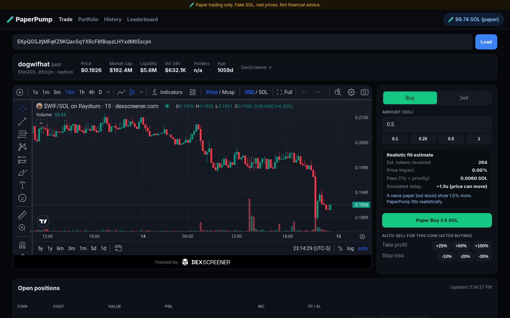
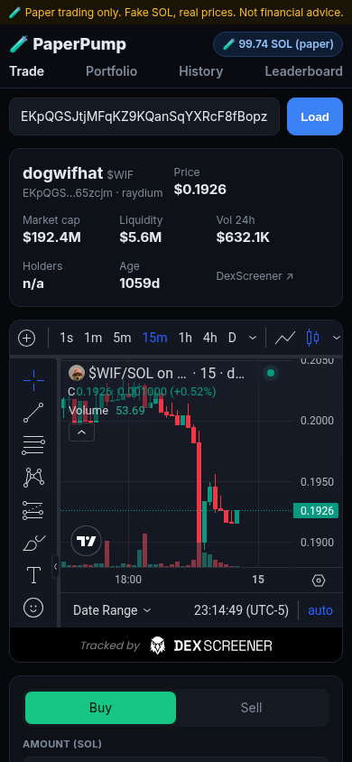
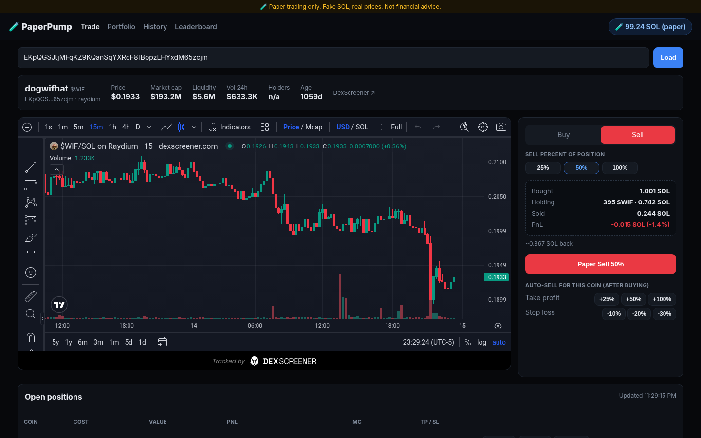
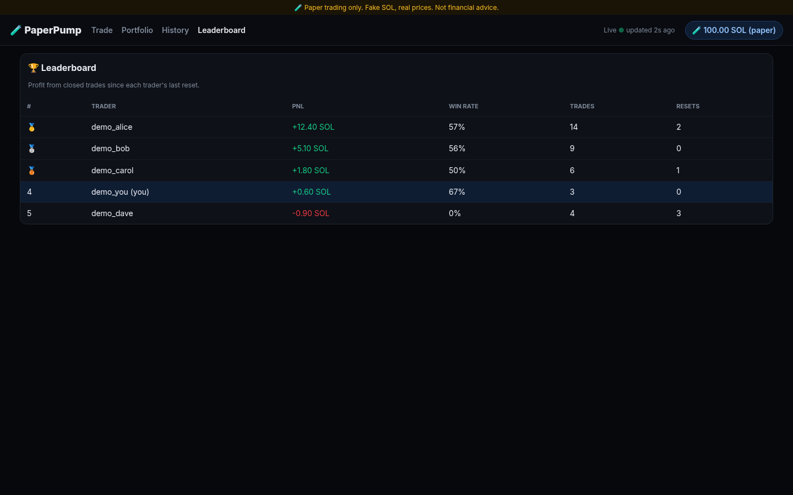

# PaperPump 🧪

[](https://github.com/Jparker9204/paperpump/actions/workflows/ci.yml)


**Paper trading for Solana memecoins: real live prices, fake SOL, realistic fills.**
It has a Telegram bot and a website that share one account, one database and one trading engine.

> ⚠️ **Paper trading only.** No wallet connection, no private keys, no real funds, ever. Nothing here is financial advice.

Most paper-trading tools fill your order at the price on screen, which makes results look better than real trading.
PaperPump models what actually happens: swap fees, priority fees, price impact from pool liquidity, and price movement during transaction latency.



| Mobile | Position panel | Leaderboard (demo data) |
|---|---|---|
|  |  |  |

## Features
- **Telegram bot** (button-driven, no commands to memorise). Paste a contract address to get a token card with Buy buttons. It also has a portfolio with Sell 25/50/100%, take-profit/stop-loss presets, stats, history, a leaderboard, and a reset with a cooldown.
- **Website**: live DexScreener chart, buy/sell panel, a position summary (bought / holding / sold / PnL), and Portfolio, History and Leaderboard pages. Prices and PnL refresh about every 1.2 seconds with no page reload, and polling pauses when the tab is hidden.
- **Passwordless login**: the bot sends a one-time HMAC-signed login link that expires in 10 minutes. There's an optional password gate for private previews, and noindex/robots rules.
- **Background TP/SL checker** that auto-sells positions and notifies you.
- **Rate-limit aware price feed**: a 1-second shared cache, request coalescing, batched lookups (30 mints per call), a per-minute budget and 429 backoff.

## Architecture
```
Telegram ⇄ bot.py (python-telegram-bot, long polling)        Browser ⇄ web.py (FastAPI + plain HTML/JS)
                    \                                          /
                     service.py: trading rules, per-user locks
                     /                      \
         fill.py: fill model (pure)    prices.py: DexScreener client (cache/coalesce/backoff)
                     \
                      db.py: SQLite in WAL mode, shared by both processes
```
- The bot and the website run as **separate processes** that share one SQLite file. Every trade runs in a `BEGIN IMMEDIATE` transaction that re-checks the balance and the position *inside* the transaction, so two processes can never overspend or sell the same position twice. There's a test that covers this.
- No ORM and no frontend build step. It's meant to be easy to read.

## Fill model
| Component | How it's simulated |
|---|---|
| Fees | 1% swap fee per side (pump.fun-like) plus a priority fee (default 0.001 SOL) |
| Price impact | Constant-product approximation `x·y=k`. The SOL reserve is estimated from DexScreener's USD liquidity |
| Latency | Quote, wait N seconds (default 1.5), quote again, then fill at the new price ("drift") |
| Honesty check | Each buy shows how much a naive "fill at the displayed price" tool would have given you |

This is an approximation. Real bonding curves and concentrated-liquidity pools behave differently. See [PLAN.md](PLAN.md).

## Run it
```bash
python3.12 -m venv .venv && source .venv/bin/activate
pip install -r requirements-dev.txt
cp .env.example .env          # add TELEGRAM_BOT_TOKEN (from @BotFather), SESSION_SECRET, optional SITE_PASSWORD, BASE_URL
python -m paperpump.bot                                         # Telegram bot
uvicorn paperpump.web:app --host 127.0.0.1 --port 8000          # website
```

## Tests
```bash
pytest -q      # 50+ tests: fill math, PnL, DB and cross-process safety, auth/login links, API, bot handlers, price-cache behaviour
ruff check .
```
CI (GitHub Actions) runs ruff and pytest on every push.

## Tech
Python 3.12 · python-telegram-bot 21 · FastAPI · SQLite (WAL) · httpx · DexScreener API · vanilla JS/CSS · pytest · ruff · GitHub Actions

## Disclaimer
PaperPump is an educational simulator. It never connects to a wallet or executes real transactions. Simulated results don't predict real trading results. Not financial advice.

Licensed under the [MIT License](LICENSE).

## Hosting: from a tunnel to a VPS

PaperPump first ran on my dev machine, exposed to the internet through a free
ngrok tunnel. That setup was fragile: the tunnel kept dropping with heartbeat
timeouts, and the Telegram bot's event loop would occasionally freeze, so the
bot looked online but stopped answering.

My first fix was local watchdog scripts that restarted the tunnel and the bot.
That helped, but it was patching symptoms, so I moved PaperPump to a $6/mo
DigitalOcean Droplet. The whole server is set up by a single cloud-init
user-data script ([`deploy/digitalocean/`](deploy/digitalocean/)) pasted in at
Droplet creation:

- **systemd services** for the web app and bot, with `Restart=always`
- **Freeze detection**: the bot writes a heartbeat file; a systemd timer restarts it if the heartbeat goes stale
- **Caddy** reverse proxy with automatic HTTPS
- **ufw** firewall (SSH, HTTP, HTTPS only) and **unattended-upgrades** for security patches
- **No secrets in the repo**: the Telegram token is entered on the server (`paperpump-set-token`) and never stored in the script or repo
- **One-command updates**: `paperpump-update` pulls the latest code and restarts the services

Later I moved the site off the sslip.io hostname to a custom domain registered with Cloudflare:
a DNS-only A record points at the Droplet, Caddy issued the HTTPS certificate automatically,
and updating `BASE_URL` made the bot's signed login links use the domain
([steps](deploy/digitalocean/README.md#custom-domain-optional)).
